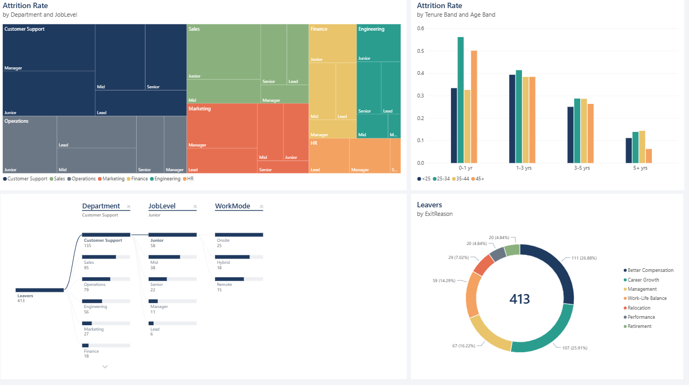
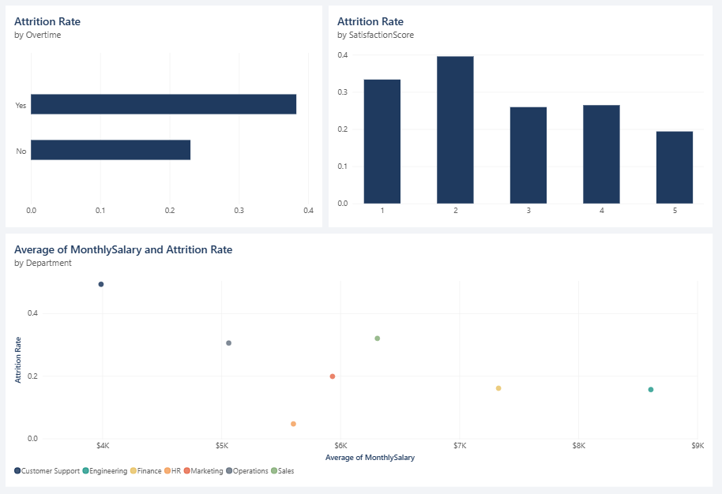

# Why Are We Losing Our People? An HR Attrition Case Study (Power BI)

**Analyst:** [Nuelwumi2024](https://github.com/Nuelwumi2024) · **Tools:** Power BI, DAX, Power Query, Python · **Report:** [`report/HR_Attrition_Dashboard.pbix`](report/HR_Attrition_Dashboard.pbix)

> **Disclaimer:** *Brightwave Commerce* is a fictional company and all data is synthetic (seeded and reproducible via `src/generate_data.py`). This is a portfolio case study built to demonstrate people-analytics skills, not a real engagement.


---

## 1. The Situation

**Brightwave Commerce** is a (fictional) mid-sized e-commerce and retail-technology company with 1,500 people hired since 2016 across seven departments: Engineering, Sales, Customer Support, Marketing, Finance, HR and Operations.

In 2025 the leadership team noticed three things at once: recruiting was running flat out, customer-support queues were growing, and the CFO flagged a rising bill for agency hires and onboarding. The CHRO was asked a simple question at the board meeting:

> *"Are we losing too many people, who are they, why are they leaving, and what is it costing us?"*

There was no single answer. HR data sat in spreadsheets, attrition was tracked as one company-wide number, and nobody could say where the problem was concentrated. This project builds the analysis that answers it.

## 2. The Business Problem

| Question | Why it matters |
|---|---|
| How bad is attrition, and is it getting worse? | Sets urgency and the size of the prize |
| Where is it concentrated (department, level, tenure)? | Lets leaders target action instead of spreading budget thin |
| Why do people leave? | Separates fixable causes (pay, workload, management) from natural churn |
| What does it cost? | Turns an HR issue into a financial case the CFO will act on |

## 3. The Approach

1. **Cleaned and modelled** employee and department data in Power Query as a star schema (employees fact, departments and date dimensions).
2. **Defined the metrics in DAX**: active headcount, leavers, attrition rate, early attrition, tenure and age bands, and an estimated replacement cost (50% of annual salary per leaver, a common HR rule of thumb).
3. **Built a three-page report** that moves from *what is happening* to *why* to *what to do*.

```
departments (dim) 1 ---- * employees (fact) * ---- 1 DateTable (dim)
                                   HireDate        = active relationship
                                   TerminationDate = inactive (USERELATIONSHIP)
```

## 4. The Findings

### Page 1: The size of the problem


- Brightwave has **1,087 active employees** and has lost **413 people** since 2016, an overall attrition rate of **27.5%**.
- Attrition has accelerated sharply. Leavers rose from **17 in 2021 to 183 in 2025**, while hiring has slowed (144 hires in 2025 against 183 exits). **For the first time, the company is losing more people than it hires.**
- The estimated replacement cost of those exits is **$13.0 million**.
- The pain is not evenly spread. **Customer Support loses 49% of its people**, followed by Sales (32%) and Operations (31%). HR (5%), Engineering and Finance (about 16%) are stable.

### Page 2: Why people leave



- **Compensation (27%) and career growth (26%)** drive over half of all exits. Management (16%) and work-life balance (14%) add another 30%.
- **Attrition is a new-joiner problem.** Employees with under a year of tenure leave at **43%**, and 1-3 years at **39%**, versus **13% for people with five or more years**. About **61% of all leavers had been at the company less than three years.**
- **Junior staff leave at 41%**, almost double the rate of senior staff (20%).
- In Customer Support, junior employees alone account for 58 of the department's 135 exits, and the decomposition tree shows the loss spread across onsite, hybrid and remote staff, so this is not a work-location issue.

### Page 3: What drives it



- **Overtime is a major warning sign.** Employees working overtime leave at **38%** versus **23%** for those who don't. In Customer Support, overtime workers leave at **65%**.
- **Low engagement predicts exits.** Satisfaction scores of 1-2 show **33-40%** attrition versus **19%** at a score of 5.
- **Pay lines up with attrition.** Customer Support has the lowest average monthly salary (about $4.0K) and the highest attrition. Engineering pays the most (about $8.6K) and loses far fewer people.

## 5. The Story in One Paragraph

Brightwave does not have a company-wide retention problem; it has a **concentrated, fixable one**. The people most likely to leave are **junior, early-tenure employees in Customer Support, Sales and Operations**, who are underpaid relative to peers, working overtime and disengaged. They leave mainly for **better pay and a clearer career path**. Each exit costs roughly half a year's salary, and the problem has accelerated to the point that the company is now shrinking despite heavy hiring.

## 6. Recommendations

| Priority | Action | Expected impact |
|---|---|---|
| 1 | **Run a pay-benchmark review for Customer Support and junior Sales/Operations roles** and close the gap to market | Addresses the top exit reason (27%) in the highest-risk group |
| 2 | **Cap and monitor overtime**, starting with Customer Support; hire to cover peak demand instead of stretching existing staff | Overtime is linked to a 15-point jump in attrition (a 24-point jump in Customer Support, 41% to 65%) |
| 3 | **Launch a first-two-years programme**: structured onboarding, a 90-day check-in, a mentor and a visible promotion path | Targets the 61% of exits that happen before year three |
| 4 | **Set up an early-warning list** using satisfaction score, overtime and tenure, reviewed monthly by HR business partners | Moves HR from reacting to exits to preventing them |
| 5 | **Train managers in the weakest teams** (management drives 16% of exits) | Lowers avoidable exits and improves engagement scores |

**Illustrative business case:** if Brightwave cut attrition in its three worst departments by one third, it would avoid roughly 100 exits and save an estimated **$3M+ in replacement cost**, before counting lost productivity and customer impact.

## 7. Skills Demonstrated

- **Data modelling:** star schema, active and inactive relationships, a dedicated date table
- **DAX:** time intelligence (`SAMEPERIODLASTYEAR`), `USERELATIONSHIP`, calculated columns for tenure and age bands, cost modelling
- **Power Query:** type cleaning, null handling and standardising blank values
- **Visual design:** custom theme, KPI cards, treemap, decomposition tree, scatter and donut charts
- **Storytelling:** moving from KPI to root cause to a costed recommendation, written for executives

## 8. Repository

```
data/    synthetic CSVs (employees, departments)
dax/     measures.dax - every measure and calculated column used
theme/   hr-theme.json - custom Power BI theme
report/  HR_Attrition_Dashboard.pbix - the finished report
images/  dashboard screenshots
src/     generate_data.py - reproduces the dataset
```

**To open the report:** download `report/HR_Attrition_Dashboard.pbix` and open it in Power BI Desktop (Windows).

**To rebuild from scratch:** load both CSVs, add `DateTable` and the columns and measures from [`dax/measures.dax`](dax/measures.dax), then apply `theme/hr-theme.json`.

```bash
pip install pandas numpy
python src/generate_data.py   # regenerates the data
```

## 9. About

Built by **[Nuelwumi2024](https://github.com/Nuelwumi2024)**. See my other analytics projects on GitHub, including a companion [Excel sales dashboard](https://github.com/Nuelwumi2024/excel-retail-sales-dashboard).
