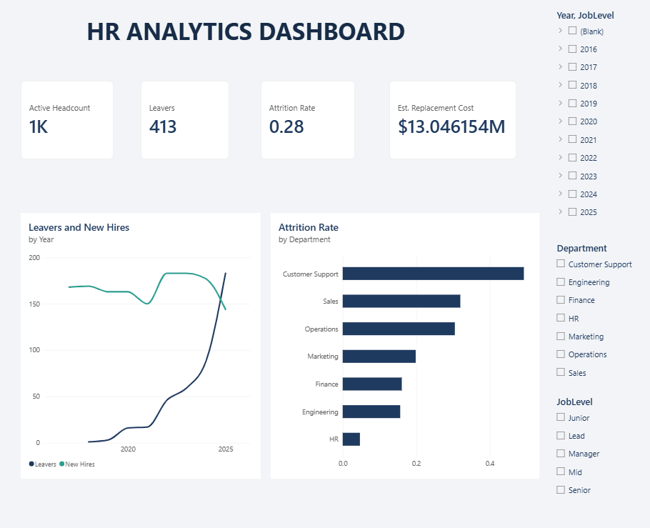

# HR Attrition & Workforce Analytics (Power BI)

People analytics is one of the most in-demand BI use cases: every company wants to know **who is leaving, why, and what it costs**. This project is a complete Power BI build kit: a star-schema dataset, a tested set of DAX measures, a custom theme and a page-by-page report spec.

> **Status:** data, DAX, theme and design spec are included. The `.pbix` itself must be assembled in Power BI Desktop (about 20 minutes with the guide below) because Power BI files can't be generated outside Desktop. Once built, save it to `report/` and add screenshots to `images/`.

## Dashboard preview

### Executive Overview



KPI cards (active headcount, leavers, attrition rate, estimated replacement cost), a leavers-versus-new-hires trend, and attrition by department, with Year, Department and Job Level slicers.

## Business questions answered

1. What is our attrition rate, and how does it trend over time?
2. Which departments, job levels and tenure bands lose the most people?
3. Why do people leave (compensation, growth, management...)?
4. Do overtime, low satisfaction or below-market pay predict exits?
5. What does attrition cost us?

## Data model

```
departments (dim) 1 ---- * employees (fact) * ---- 1 DateTable (dim)
                                   HireDate     = active relationship
                                   TerminationDate = inactive (USERELATIONSHIP)
```

| File | Rows | Notes |
|---|---|---|
| `data/employees.csv` | 1,500 | One row per employee ever employed; blank `TerminationDate` = still active |
| `data/departments.csv` | 7 | Department lookup |

The data is **synthetic and seeded** (`src/generate_data.py`). Exit probability is driven by department, overtime, satisfaction, pay level and job level, so the dashboard surfaces real, explainable patterns (about 27% historical attrition; overtime and low-satisfaction staff leave far more often).

## Build guide

1. **Get Data > Text/CSV:** load both CSVs from `data/`. In Power Query set `HireDate` / `TerminationDate` to *Date* and numeric columns to *Whole/Decimal Number*.
2. **Model view:** create `employees[DepartmentID] -> departments[DepartmentID]`. Add `DateTable` (first block of `dax/measures.dax`), relate `HireDate` (active) and `TerminationDate` (inactive) to `DateTable[Date]`. Mark `DateTable` as a date table.
3. Add the calculated columns and measures from [`dax/measures.dax`](dax/measures.dax). Keep measures in a `_Measures` table.
4. **View > Themes > Browse for themes:** import [`theme/hr-theme.json`](theme/hr-theme.json).
5. Build the pages below.

### Page 1 - Executive Overview
- **Cards:** Active Headcount, Leavers, Attrition Rate, Early Attrition %, Est. Replacement Cost
- **Line chart:** `Leavers` and `New Hires` by `DateTable[Year-Month]`
- **Bar chart:** Attrition Rate by `departments[Department]`
- **Slicers:** Year, Department, Job Level

### Page 2 - Why People Leave
- **Donut / bar:** Leavers by `ExitReason`
- **Clustered column:** Attrition Rate by Tenure Band and by Age Band
- **Matrix (heatmap):** Department x Job Level, values = Attrition Rate, with conditional formatting
- **Decomposition tree:** Analyze `Leavers` by Department > Job Level > WorkMode

### Page 3 - Drivers & Engagement
- **Clustered bar:** Attrition Rate by Overtime (Yes/No)
- **Column:** Attrition Rate by `SatisfactionScore` (1-5)
- **Scatter:** Avg Monthly Salary vs Attrition Rate, bubble = headcount, by Department
- **Key influencers visual:** explain `Attrition = Left` using Overtime, SatisfactionScore, JobLevel, WorkMode, Age Band

### Polish checklist
Titles on every visual, a navigation bar between pages, tooltips on the KPI cards, conditional colour on the Attrition card using `Attrition KPI Colour`, and "Edit interactions" tuned so slicers don't filter the trend chart unintentionally.

## Insights to call out (verify against your build)
- Customer Support (~49%), Sales (~32%) and Operations (~31%) carry the highest attrition; HR (~5%), Engineering and Finance (~16%) the lowest.
- Employees working overtime leave at ~38% versus ~23% for those who don't.
- Satisfaction scores of 1-2 show 33-40% attrition versus ~19% at score 5.
- Exits concentrate in the first 1-3 years of tenure, so onboarding and early-career growth are the lever.

## Repo layout

```
data/    synthetic CSVs
dax/     measures.dax
theme/   hr-theme.json
src/     generate_data.py (reproduces the data)
report/  put your .pbix here
images/  put dashboard screenshots here
```

## Regenerate the data

```bash
pip install pandas numpy
python src/generate_data.py
```
